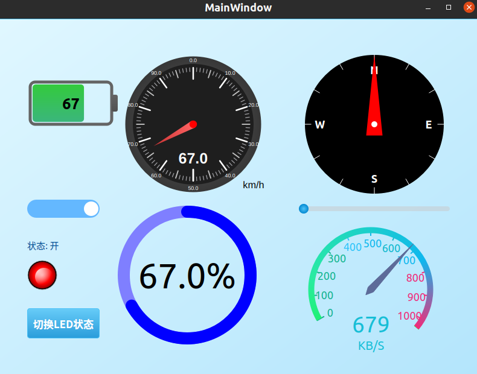

# Qt Custom Widgets · 轻量级 Qt Widgets 控件合集

[](https://github.com/frankwang98/qt_custom_widget/actions/workflows/qt-build.yml)

**Qt5 / Qt6 · C++17 · CMake + qmake · Widgets**

面向桌面仪表盘、设备监控和工具软件的 C++/Qt Widgets 控件合集。核心提供七个可复用控件，CMake 静态库和交互 Gallery；保留 qmake 兼容与三个独立示例。



## 控件

| 控件 | 用途 | 主要 API |
| --- | --- | --- |
| Battery | 电量和报警状态 | `setValue`, `setRange`, `setAlarmValue` |
| DashBoard | 通用仪表盘 | `setValue`, `setMinValue`, `setMaxValue`, `setUnit` |
| CompassWidget | 方位角 | `setAngle` |
| RingProgressWidget | 圆环进度 | `setRange`, `setValue`, `setRingColor` |
| SwitchButton | 带动画的开关 | `setChecked`, `toggled` |
| LedIndicator | LED 状态灯 | `setOn`, `setOnColor`, `stateChanged` |
| Speedometer | 数值/速度表盘 | `setIndicatorValue`, `setUnitText`（量程固定 0–1024） |

> 不同控件历史 API 命名有所差异；本次保留已有 API，避免破坏旧项目。

## 构建（推荐 CMake）

要求 CMake >= 3.16、C++17、Qt 5 或 Qt 6（Widgets）。

```bash
cmake -S . -B build -DCMAKE_BUILD_TYPE=Release
cmake --build build -j
./build/qt_widget_gallery
```

在 Windows 上使用对应构建配置下的可执行文件。仅使用控件库可设置 `-DBUILD_WIDGET_DEMO=OFF`。

其他 CMake 项目可以用 `add_subdirectory(path/to/qt_custom_widget)`，然后 `target_link_libraries(your_app PRIVATE qt_custom_widgets)`。

仍支持在 Qt Creator 中打开 `qt_custom_control.pro`，或使用 qmake + make。

## 最小集成示例

在上层 CMake 项目中添加：

```cmake
add_subdirectory(external/qt_custom_widget)
target_link_libraries(your_app PRIVATE qt_custom_widgets)
```

```cpp
#include "ringprogresswidget.h"
#include "switchbutton.h"

// parent 是已有 QWidget*；将控件加入自己的布局。
auto *progress = new RingProgressWidget(parent);
progress->setRange(0, 100);
progress->setValue(65);

auto *power = new SwitchButton(parent);
power->setChecked(true);
```

## 交互与布局

主 Demo 使用滚动网格布局，支持调整窗口尺寸；电量、仪表盘和进度自动演示，指南针与速度表盘可拖动滑块，LED 可通过按钮或开关切换。顶部可切换浅色、深色、AMOLED、Material 与系统主题。开关支持鼠标和 Space/Enter 键，并显示键盘焦点。绘制使用 Qt 的逻辑坐标，建议在目标系统上检查高 DPI 缩放、窗口缩放与不同字体。

## 其他独立示例

- [绘图与设计模式](examples/drawing/README.md)：`examples/drawing/draw.pro`
- [停车场动画](examples/parking/README.md)：`examples/parking/park.pro`
- `bg/bg.pro`：按钮示例

这些示例保留独立 qmake 工程，不包含在主控件库中，也不在当前 CMake CI 范围内。

## 仓库结构

- 根目录：七个控件的 `.h/.cpp`、CMake 静态库及 Gallery
- `style/`：Gallery 的 QSS 主题
- `examples/drawing/`：绘图与设计模式独立示例
- `examples/parking/`：停车场动画独立示例
- `bg/`：TechButton 按钮独立示例
- `.github/workflows/`：Qt5 / Qt6 CI

## 验证

GitHub Actions 对 Qt5/Qt6 执行 CMake 构建。CI 不等同于人工 GUI 视觉验收；请在本机运行 Gallery 验证外观与交互。

## License

MIT，详见 [LICENSE](LICENSE)。
